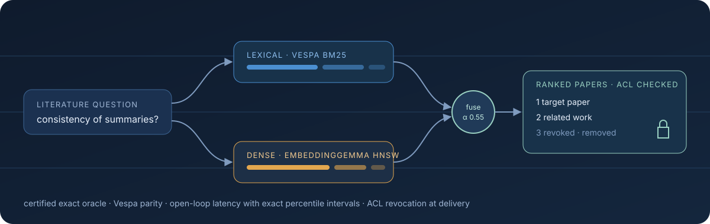
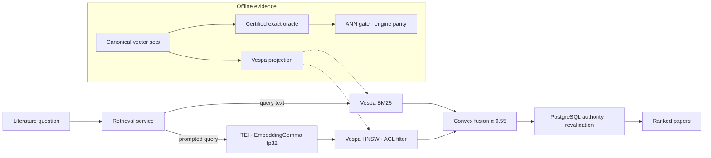

# Scientific literature retrieval with verifiable evidence

[](https://github.com/chrisdeleongarciaa-pixel/mlops-search-retrieval/actions/workflows/tests.yml)



A hybrid search system for scientific literature, deployed on rented GPUs and measured end to end: BM25 and EmbeddingGemma retrieval in Vespa, convex fusion chosen on development data, access control revalidated in PostgreSQL at delivery, and query encoding served by TEI. Every quality figure is reported once on a held-out test split with a paired confidence interval, and every ANN figure is measured against a certified exact oracle.

## Results

**LitSearch** (64,183 ML and NLP papers, 300 held-out test questions, EmbeddingGemma-300M in float32). The fusion was chosen on 258 development questions and reported once on test. [Verification](docs/verification/serving.md) · [Evidence](evaluation/evidence/README.md)

| System | nDCG@10 | R@100 | R@5 specific | R@20 broad |
| --- | ---: | ---: | ---: | ---: |
| BM25 (Vespa) | 0.406 | 0.766 | 52.9 | 43.4 |
| Dense, EmbeddingGemma HNSW | 0.463 | 0.864 | 57.2 | 55.8 |
| **Hybrid, convex α = 0.55** | **0.528** | **0.884** | **65.8** | **62.2** |

The hybrid beats the dense branch by **+0.065 nDCG@10, paired 95 % interval [0.038, 0.094]**, on both GPU hosts it was deployed on. In the LitSearch paper's own measures (Ajith et al., 2024, Table 3, all 597 questions) BM25 scores 50.0 / 39.9, E5-large-v2 56.2 / 55.4 and GritLM-7B 74.8 / 70.8: the 300M-parameter hybrid sits between E5-large-v2 and a 7B model. This split is a stratified sample of the paper's questions; BM25 matching the paper within its interval checks that the measures agree. [Comparison](evaluation/evidence/gpu-final-rtx4090-2026-11-19/reports/litsearch-compare.json)

**MS MARCO passage** (8,841,823 passages, 6,980 dev queries). [Oracle and ANN gate](docs/verification/exact-oracle-ann.md#executed-on-a-gpu)

| Measure | Result |
| --- | --- |
| EmbeddingGemma exact retrieval, RR@10 | **0.325**, against 0.187 for Anserini BM25 (paired +0.137, 95 % [0.128, 0.146]) |
| Certified exact oracle | All 6,980 queries certified in five selectivity cohorts, no full scan, observed error 1.3e-6 under a bound of 4.6e-5 |
| HNSW recall@10 against the oracle (M 16, efC 200) | 0.965 at efSearch 100 (21,096 q/s) to 0.992 at 1,024 (2,789 q/s); three insertion orders within 0.002 |
| Filtered HNSW at 1 % / 0.1 % eligible | 0.937 / 0.440 at efSearch 1,024: why the engine switches to exact search below 2 % |
| Reproducibility | The 8.8 M-row vector set encoded on two different RTX 4090 hosts has the same SHA-256 |

**Serving and access control** (LitSearch on an RTX 3090 VM). [Verification](docs/verification/serving.md#executed-on-a-gpu)

| Gate | Result |
| --- | --- |
| Engine parity | Vespa's exact search equals the oracle's top 100 for 300 of 300 queries in five cohorts (gap 2.1e-7) |
| Dense route latency, open-loop, 5,000 samples per point | p95 37–41 ms at 10 q/s, 38–48 ms at 20 q/s, with exact 95 % intervals |
| Hybrid route latency | p95 86–92 ms at 10 q/s with its branches in sequence; the branches now run in parallel (not yet measured under load) |
| ACL-01 revocation | 0 leaks in 683 revocations; delivery exclusion p99 9.1 ms against a 1 s limit |
| Adapter conformance and the MTEB figure | Max error 3.1e-7 on CUDA; SciFact nDCG@10 0.78675, equal to the published figure |

## Architecture



Canonical vectors live in hashed shards outside the engine, and the Vespa collection is a projection rebuilt from them. Runs are bound to git: a run refuses a dirty tree, test judgments are read only by a report against a development configuration committed earlier, and every artifact is a sealed manifest with its hashes. [Architecture](docs/architecture.md) · [Serving contract](docs/contracts/serving.md) · [Oracle contract](docs/contracts/exact-oracle-ann.md)

## Reproduce

CPU tests on Linux with CPython 3.12, as CI runs them, then the whole workbench on a rented GPU VM:

```sh
pip install --require-hashes --only-binary=:all: -r config/requirements-cpu-linux-amd64.lock -r config/requirements-pdf.lock -r config/requirements-ann-linux-amd64-cpu.lock && pip install --no-deps --no-build-isolation -e .
python -m unittest discover -s tests/unit && PYTHONUTF8=1 python -m unittest discover -s evaluation
python infra/gpu/vast/vast.py offers --phase A   # then infra/gpu/vast/launch.sh, see infra/gpu/README.md
```

The GPU procedure rents a vast.ai VM, installs the driver and Docker, runs [`run-all.sh`](infra/gpu/run-all.sh) under a guard that keeps the instance after a failure and stops it at its time limit, and copies the results back. [GPU procedure](infra/gpu/README.md)

## Not yet measured

The parallel hybrid branches, ACL-01 with its widened probe and TEI's ranking impact are implemented and tested with HTTP fakes but have not run on a GPU host. TEI's query vectors agree with the canonical ones to a cosine of 0.9999995 but exceed the 1e-5 absolute tolerance. MS MARCO has not been projected into Vespa. [Open items](docs/verification/serving.md#not-executed)

## Earlier SciFact study

All quality scores below use the 300 official BEIR SciFact test queries. The HNSW and fusion rows are means across four fresh insertion orders on the same Vespa host. BM25 and dense lists were fused at depth 100 with equal-weight RRF and constant 60. [Paired-run audit](docs/verification/scifact-stability.md) · [Per-build evidence](evaluation/evidence/scifact-paired-42465181926/audit.json)

| Ranking | NDCG@10 | Recall@10 | Recall@100 |
| --- | ---: | ---: | ---: |
| BM25 | 0.66168 | 0.79094 | 0.88589 |
| E5 exact | 0.69390 | 0.80722 | 0.93933 |
| E5 HNSW | 0.69190 | 0.80639 | 0.94683 |
| E5 exact + BM25 | 0.70202 | 0.82722 | 0.95767 |
| E5 HNSW + BM25 | 0.70161 | 0.82722 | 0.95933 |
| EmbeddingGemma exact | **0.78871** | **0.91856** | 0.97500 |
| EmbeddingGemma HNSW | **0.78871** | **0.91856** | 0.97500 |
| EmbeddingGemma exact + BM25 | 0.74246 | 0.85622 | **0.98000** |
| EmbeddingGemma HNSW + BM25 | 0.74264 | 0.85622 | **0.98000** |

## System and verification

| Stage | Verified scope |
| --- | --- |
| Ingestion and publication | Idempotent acceptance and transactional outbox in PostgreSQL. Vespa activation is conditional on the current revision. Tests exercise updates, withdrawal, late workers and ACL. [Contracts](docs/contracts/witness-increments.md) · [Verification](docs/verification/witness-increments.md) |
| Scientific PDFs | GROBID and TEI produce chunks with page coordinates and verifiable byte spans. An eight-page sample yielded 94 chunks. [PDF evidence](docs/verification/scientific-pdf.md) |
| Inference and delivery | The private CPU witness used Qwen2.5-1.5B and llama.cpp. It resolved a generated citation to the accepted original and rejected unauthorized or revoked delivery. [RI-01 evidence](docs/verification/integration-gate.md) |
| MCP client | A model API calls the upstream filesystem server through one allowed read tool. The example tests rejected tools, aliases and paths. [MCP example](examples/mcp-client/) |

- [Evidence index](evaluation/evidence/README.md)
- [Reduced workbench scope](engineering/decisions/0007-reduced-workbench-scope.md)
- [Engineering runbooks](engineering/operations/README.md)
- [v0.2 checkpoint release](https://github.com/chrisdeleongarciaa-pixel/mlops-search-retrieval/releases/tag/v0.2)

## License

Project code and authored documentation are available under [Apache License 2.0](LICENSE). Referenced models, datasets, external samples and upstream components retain their respective terms.
